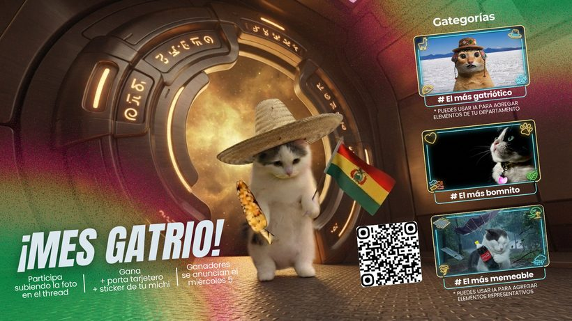
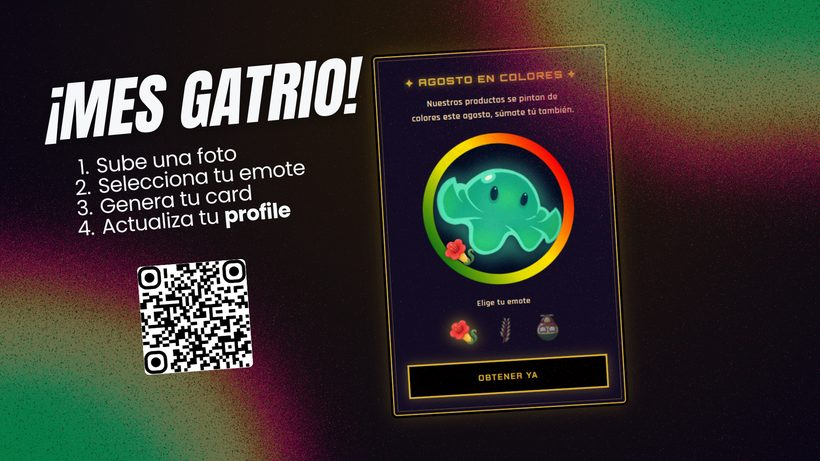
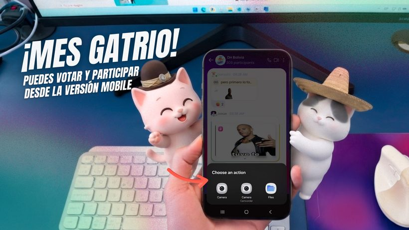

  

  

  
  
  

### ✦ El proyecto

**Mes Gatrio** fue la activación interna de agosto en Digital Harbor, que mezcló el mes patrio con el Día Internacional del Gato dentro de la campaña *Agosto en Colores*. Construí una sola página con dos funciones: un **generador de cards animadas** para la foto de perfil del equipo y un **ranking gatriótico** que muestra los puntos que se ganaron los michis en el thread de votación.

  
  

### ✦ Cómo funciona y qué medimos

  
  

### ✦ Piezas de la campaña

  
  
  

### ✦ Stack

  
  
  

  

